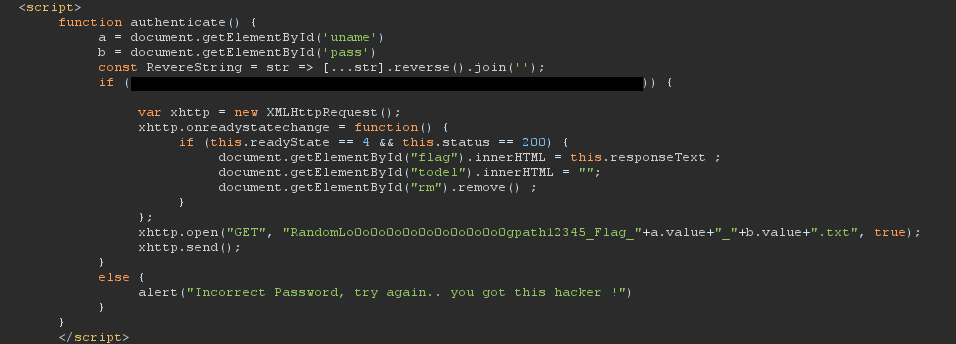
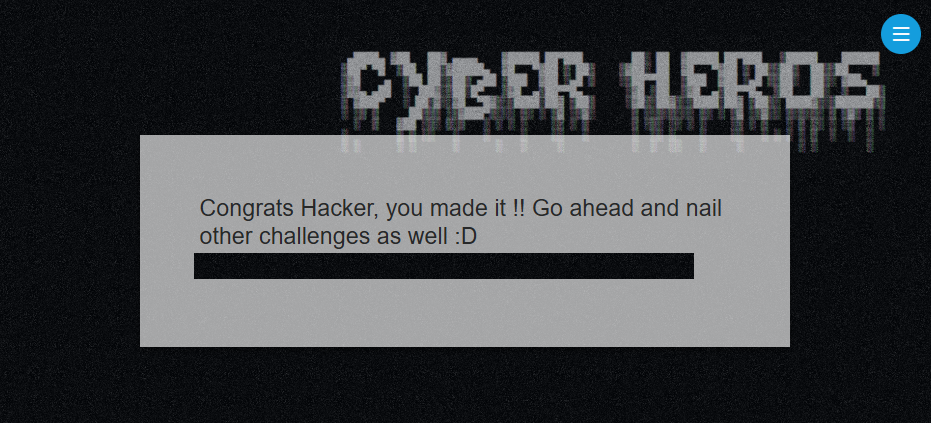

# Finding the Flag

I started by exploring the website to get an overview of its structure. I tried looking for a sitemap or other accessible pages, but the website only had two pages, the home page and the login page.

There were no username or password hints visible on either page, so I decided to inspect the HTML source for anything useful. While checking the source, I found an internal JavaScript file that had not been obfuscated or minified. It contained the login credentials, but the password was reversed.

I reversed the password back to its original form and used the credentials to log in to the website. After successfully logging in, I was able to access the page containing the flag.

